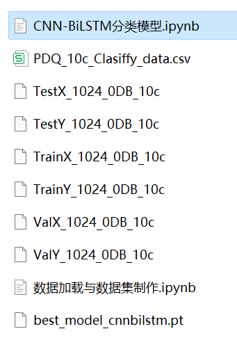

# CNN-BiLSTM Classification of Disturbance Signals in Power Quality: One-Dimensional Signal Classification

The translation provided does not include the Chinese text, but it does mention the following:
- A complete dataset of power quality disturbance signals.
- A well-made dataset of ten categories of disturbance signals, classification data, and label sets. The corresponding code can be run.
- Code for data preprocessing and CNN-BiLSTM classification model.
- Environment: Python 3.9.

Please provide the Chinese text for me to translate.

## Images

<!-- PAYMENT_BLOCK -->

## Get this dataset

- Payment link (Stripe): [Buy now](https://buy.stripe.com/3cs8yP7sY87d0vu9AB)
- Payment QR code: 

<!-- /PAYMENT_BLOCK -->
